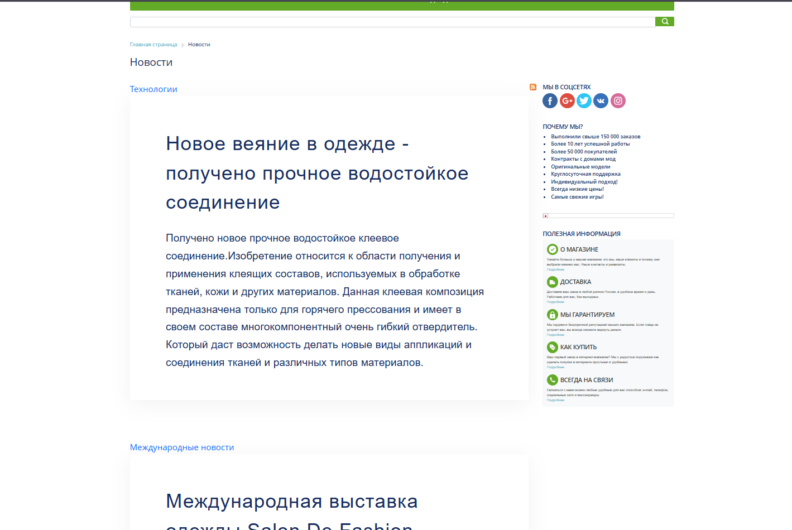
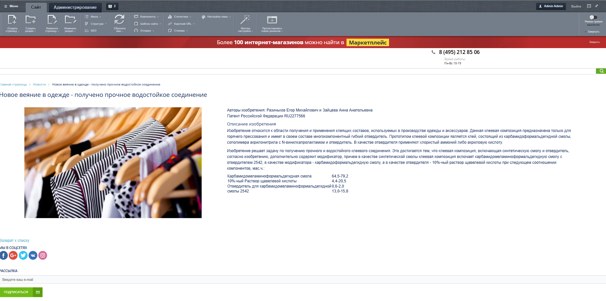

# Task_3

## Сдать тесты в администраторе

## Сделать шаблон комплексного компонента news. На главной подключить news.list, на детальной news.detail
### (Дополнительно) Сделать разбивку по разделам

1. В администратичной части в настройках типов инфоблоков для инфоблока Новости 
   - включить галочку "Использовать древовидный классификатор элементов по разделам"
   - URL страницы информационного блока: #SITE_DIR#/news/
   - URL страницы раздела: #SITE_DIR#/news/#SECTION_CODE#/
   - URL страницы детального просмотра: #SITE_DIR#/news/#SECTION_CODE#/#ELEMENT_CODE#/
2. В инфоблоке Новости добавить разделы и привязать к ним новости
3. В папку local скопировать содежримое папки src/local
4. Перейти на страницу, где находится коспонент bitrix:news (например, страница Новости)
5. В настройках компонента указать шаблон Barba и сохранить изменения
6. После этого проверить, что шаблоны применились

Страница со списком новостей. Новости разбиты на разделы (Технологии, Международные новости).

Страница с деталями новости.
