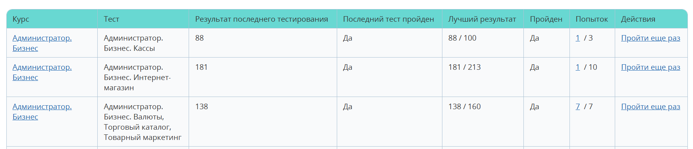

# Task_3

## Сдать тесты в администраторе

## Сделать шаблон комплексного компонента news. На главной подключить news.list, на детальной news.detail
### (Дополнительно) Сделать разбивку по разделам

