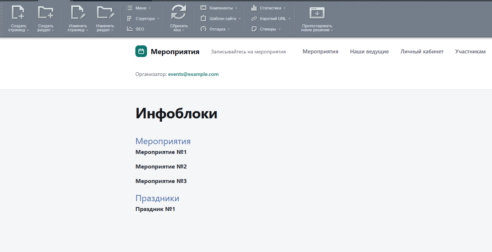
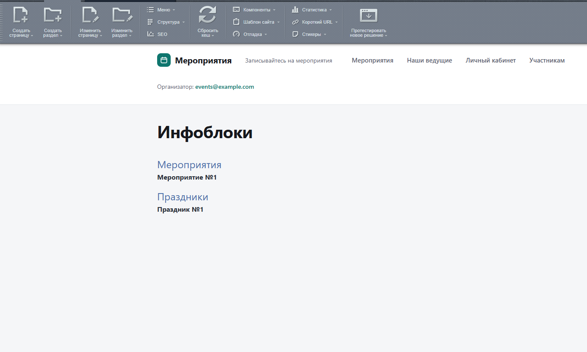

# Task_6

В папке src находится разработанный компонент `news.list.grouped`. А так же `index.php`, в котором подключается данный компонент.

> Добавить поддержку фильтрации по полям.

В файле `index.php` создан фильтр

```php
$arrFilter = [
    '%NAME' => '№1',
];
```

> Добавить проверку вводимых параметров и вывод ошибок через ShowError.
В файле `class.php`
```php
if (!$this->arParams['IBLOCK_TYPE'])
        {
            ShowError(GetMessage('IBLOCK_TYPE_NOT_SET'));
            return;
        }
```

Компонент без фильтра


Компонент с установленным фильтром
