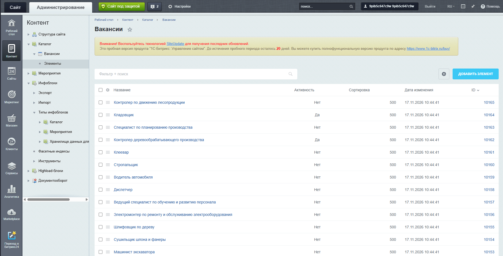
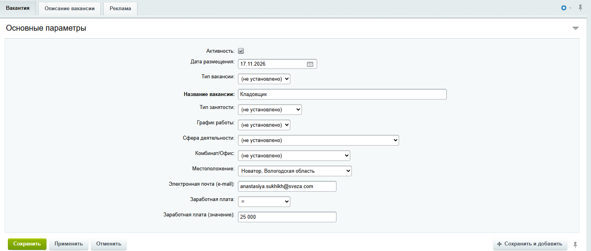
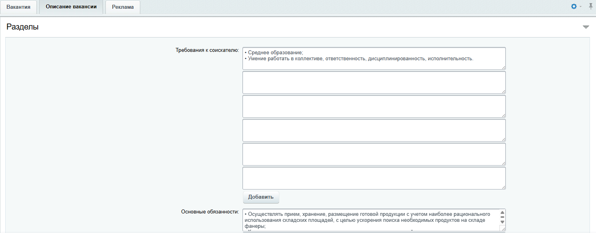

# Task_4

##Сдать тесты в кусе pазработчик

## Написать парсер, заполняющий иноблок элементами
## (Дополнительно) Парсер должен автоматически заолнять значения свойств типа "Список"

## `/src/vacancy.php` - парсер
## `/src/BlockHelper.php` - вспомогательный класс

Вакансии

Основные параметры

Разделы
