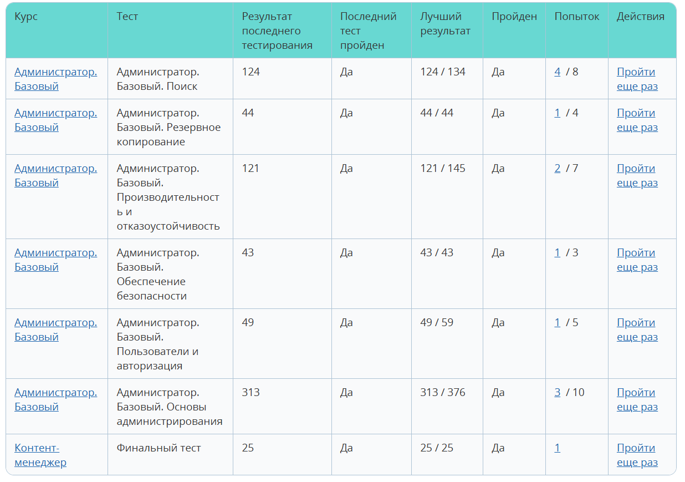

# Task_2
Bitrix:
## Сдать тесты в курсах
### Администратор. Базовый 
https://dev.1c-bitrix.ru/learning/course/index.php?COURSE_ID=35

### Администратор. Модули 
https://dev.1c-bitrix.ru/learning/course/index.php?COURSE_ID=41

## Сделать веб-форму

## Сделать шаблон компонента form.result.new, интегрированный с формой
